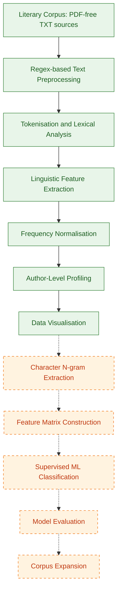
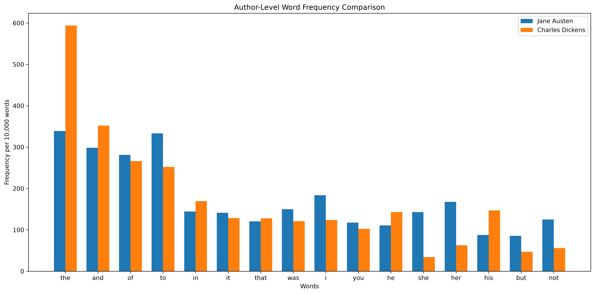

# Style Fingerprint
### Computational Stylometry & Authorship Attribution


An independent computational linguistics and Natural Language Processing (NLP) project investigating how linguistic patterns and statistical features can be used to distinguish individual authors' writing styles.

Developed alongside my postgraduate studies in Computer-Assisted Language Mediation (CALM) at Ghent University, this project bridges linguistic theory, Python programming, statistical text analysis, feature engineering and machine learning.

> **Current status:** Corpus preprocessing, lexical analysis, linguistic feature extraction and exploratory visualisation have been implemented. Character n-gram analysis and supervised machine learning classification represent the next development stages.

---

## Table of Contents

- [Research Objective](#1-research-objective)
- [Dataset](#2-dataset)
- [Methodology](#3-methodology)
- [Pipeline Architecture](#4-pipeline-architecture)
- [Preliminary Results](#5-preliminary-results)
- [Limitations and Error Analysis](#6-limitations-and-error-analysis)
- [Repository Structure](#7-repository-structure)
- [Installation and Usage](#8-installation-and-usage)
- [Development Roadmap](#9-development-roadmap)
- [Extensibility and Future Research](#10-extensibility-and-future-research)
- [Technologies](#11-technologies)
- [Author](#12-author)

---

## 1. Research Objective

Can an author's writing style be computationally represented through measurable linguistic patterns?

Style Fingerprint explores this question through computational stylometry, a field concerned with the quantitative analysis of writing style.

The project investigates how linguistic features, particularly function-word distributions and lexical patterns, can contribute to identifying stylistic similarities and differences between authors.

### Research Questions

- How do function-word distributions vary between authors?
- Which linguistic features may contribute to distinguishing individual writing styles?
- How consistent are stylistic patterns across different works by the same author?
- Can linguistic features support automated authorship attribution on previously unseen texts?

### Long-Term Objective

To develop a reproducible and extensible computational stylometry pipeline capable of supporting machine learning-based authorship attribution across larger literary corpora, additional authors and different genres.

---

## 2. Dataset

The initial experimental corpus consists of four English-language novels obtained from [Project Gutenberg](https://www.gutenberg.org/).

| Author | Literary Work | Local Filename |
|---|---|---|
| Jane Austen | Emma | `austen_emma.txt` |
| Jane Austen | Pride and Prejudice | `austen_pride.txt` |
| Charles Dickens | A Tale of Two Cities | `dickens_cities.txt` |
| Charles Dickens | Oliver Twist | `dickens_twist.txt` |

### Data Sources

- [Emma — Jane Austen](https://www.gutenberg.org/ebooks/158)
- [Pride and Prejudice — Jane Austen](https://www.gutenberg.org/ebooks/1342)
- [A Tale of Two Cities — Charles Dickens](https://www.gutenberg.org/ebooks/98)
- [Oliver Twist — Charles Dickens](https://www.gutenberg.org/ebooks/730)

### Corpus Design

- **Authors:** 2
- **Literary works:** 4
- **Language:** English
- **Text format:** Plain text (`.txt`)
- **Source:** Project Gutenberg

The selected novels constitute an initial pilot corpus for developing and validating the preprocessing and linguistic analysis pipeline.

The project is not intended to remain restricted to these four literary works.

---

## 3. Methodology

The current methodology follows a modular computational linguistics pipeline.

### 3.1. Corpus Preprocessing

Raw literary texts contain structural and non-literary elements that may introduce noise into linguistic analysis.

The preprocessing stage addresses these issues through:

- Removal of Project Gutenberg metadata.
- Removal of non-literary headers and footers.
- Automated chapter-heading removal using regular expressions.
- Text-specific cleaning rules.
- Validation of cleaned textual content.

**Implementation:** `src/text_cleaning.py`

### 3.2. Tokenisation and Lexical Analysis

Cleaned texts are processed to extract lexical information and establish a foundation for subsequent linguistic feature engineering.

The implemented analysis includes:

- Text tokenisation.
- Total token counts.
- Unique token counts.
- Word-frequency distributions.
- Comparative lexical analysis.

**Implementation:** `src/text_analysis.py`

### 3.3. Linguistic Feature Extraction

The project examines selected function words as interpretable stylometric features.

Function words are frequently used in natural language and may reveal stylistic preferences that are less directly related to subject matter than many content words.

The current feature set includes:

| Linguistic Category | Examples |
|---|---|
| Determiners | the |
| Conjunctions | and, but |
| Prepositions and grammatical markers | of, in, to |
| Pronouns and related forms | it, I, you, he, she, her, his |
| Grammatical words | that, was, not |

The grammatical functions of individual words may vary depending on their context.

### 3.4. Frequency Normalisation

Literary works differ considerably in length. Raw word counts alone would therefore produce misleading comparisons.

To account for these differences, function-word frequencies are normalised per 10,000 tokens.

```math
f_{\mathrm{norm}}(w)
=
\frac{\mathrm{count}(w)}{N}
\times 10,000
```

Where:

- `count(w)` represents the frequency of a selected word.
- `N` represents the total number of tokens in the analysed text.
- `f_norm(w)` represents its normalised frequency.

This approach supports comparisons between texts of unequal lengths.

### 3.5. Author-Level Profiling

The extracted linguistic features are used to construct exploratory author-level profiles.

These profiles provide a quantitative representation of selected stylistic characteristics and support comparisons between the authors in the experimental corpus.

### 3.6. Data Visualisation

Matplotlib is used to visualise linguistic feature distributions and explore differences between literary texts and author-level profiles.

The generated comparison figure is stored in the `results/` directory.

### 3.7. Machine Learning — Planned

The next stage will extend the current linguistic analysis pipeline through:

- Character n-gram feature extraction.
- Numerical feature representation.
- Feature matrix construction.
- Supervised authorship classification.
- Baseline model comparison.
- Held-out evaluation.
- Classification error analysis.

Machine learning classification has not yet been completed.

---

## 4. Pipeline Architecture



Solid connections represent implemented stages, while dashed connections represent planned extensions.

---

## 5. Preliminary Results

### Author-Level Function-Word Comparison



*Figure 1. Exploratory comparison of selected function-word frequencies between Jane Austen and Charles Dickens, expressed as occurrences per 10,000 tokens.*

The visualisation demonstrates variation in the distributions of selected linguistic features across the two author profiles.

The current results suggest several patterns worth investigating further:

- Differences in personal-pronoun distributions.
- Variation in the frequency of selected grammatical words.
- Potential differences in narrative perspective and stylistic preferences.
- Similarities and differences in frequently used function words.

### Within-Author Variation

The following values illustrate variation between two works by Jane Austen:

| Function Word | Emma | Pride and Prejudice |
|---|---:|---:|
| the | 323.49 | 354.98 |
| and | 304.40 | 292.45 |
| of | 266.86 | 295.71 |
| to | 325.85 | 340.48 |
| she | 146.95 | 139.47 |
| her | 154.35 | 181.56 |

*Values are normalised occurrences per 10,000 tokens from a recorded analysis run.*

These results highlight the importance of examining both between-author and within-author variation.

### Interpretation

The observed distributions provide an initial quantitative basis for investigating author-specific stylistic patterns.

However, these results remain exploratory. They do not establish that the selected features can reliably identify authors independently of genre, topic, narrative perspective or corpus composition.

No classification accuracy, precision, recall or F1-score is reported at this stage because a supervised classification model has not yet been evaluated.

---

## 6. Limitations and Error Analysis

The current implementation represents an exploratory research prototype.

Several limitations must be considered when interpreting its results.

| Limitation | Potential Impact |
|---|---|
| Small experimental corpus | Limited statistical generalisability |
| Only two authors | Limited diversity of writing styles |
| Book-specific preprocessing | Potential challenges with new textual sources |
| Selected function words | Incomplete representation of writing style |
| Narrative perspective | May influence pronoun distributions |
| Genre and subject matter | May introduce confounding stylistic signals |
| Tokenisation decisions | May affect calculated linguistic frequencies |
| No trained classifier | Predictive performance remains unknown |

Future evaluation will explicitly address data leakage by separating literary works across training and testing datasets wherever appropriate.

With the current small corpus, any classification experiment should be interpreted as a pilot study.

Further error analysis will be conducted following the implementation of machine learning classifiers.

---

## 7. Repository Structure

```text
style-fingerprint/
│
├── data/
│   ├── austen_emma.txt
│   ├── austen_pride.txt
│   ├── dickens_cities.txt
│   └── dickens_twist.txt
│
├── results/
│   └── function_word_comparison.png
│
├── src/
│   ├── text_analysis.py
│   └── text_cleaning.py
│
├── .gitignore
├── main.py
└── README.md
```

| File or Directory | Purpose |
|---|---|
| `main.py` | Main pipeline entry point and visualisation |
| `src/text_cleaning.py` | Regex-based corpus preprocessing |
| `src/text_analysis.py` | Tokenisation and linguistic text analysis |
| `data/` | Local literary corpus |
| `results/` | Generated analytical visualisations |
| `.gitignore` | Git exclusion rules |
| `README.md` | Project documentation |

The `data/` directory may be excluded from version control. The original literary texts can be obtained from the sources listed above.

---

## 8. Installation and Usage

### Prerequisites

- Python 3
- pip
- Matplotlib
- Git (optional)

### Step 1 — Clone the Repository

```bash
git clone https://github.com/Mo-ashaqr/style-fingerprint.git
cd style-fingerprint
```

Alternatively, download the repository directly from GitHub.

### Step 2 — Create a Virtual Environment

```bash
python3 -m venv .venv
```

Activate the environment on macOS or Linux:

```bash
source .venv/bin/activate
```

### Step 3 — Install Dependencies

```bash
python -m pip install matplotlib
```

A version-pinned dependency file will be introduced as the project develops.

### Step 4 — Prepare the Dataset

Download the four novels in plain-text format from Project Gutenberg.

Place them inside the `data/` directory using the following filenames:

```text
austen_emma.txt
austen_pride.txt
dickens_cities.txt
dickens_twist.txt
```

Create the required directories if they do not already exist:

```bash
mkdir -p data results
```

### Step 5 — Run the Pipeline

Execute the following command from the project root:

```bash
python main.py
```

### Expected Output

The current implementation is designed to produce:

- Cleaned and tokenised literary texts for analysis.
- Corpus-level lexical statistics.
- Word-frequency distributions.
- Normalised function-word frequencies.
- Exploratory author-level profiles.
- Comparative Matplotlib visualisations.

The author-level comparison figure is saved as:

```text
results/function_word_comparison.png
```

Clean-environment reproducibility and dependency compatibility will be tested in future development.

---

## 9. Development Roadmap

### Phase 1 — Corpus Engineering

- [x] Corpus collection
- [x] Project Gutenberg metadata removal
- [x] Regex-based preprocessing
- [x] Chapter-heading removal
- [x] Text cleaning validation

### Phase 2 — Linguistic Analysis

- [x] Tokenisation
- [x] Lexical statistics
- [x] Word-frequency analysis
- [x] Function-word feature extraction
- [x] Frequency normalisation
- [x] Exploratory author-level profiling
- [x] Comparative data visualisation

### Phase 3 — Advanced Feature Engineering

- [ ] Character n-gram extraction
- [ ] Feature vocabulary construction
- [ ] Text segmentation for classification
- [ ] Numerical feature representation
- [ ] TF-IDF experimentation
- [ ] Feature matrix construction

### Phase 4 — Machine Learning

- [ ] Training and testing dataset preparation
- [ ] Baseline authorship classifier
- [ ] Logistic Regression
- [ ] Naive Bayes
- [ ] Support Vector Machine
- [ ] Model comparison

### Phase 5 — Evaluation

- [ ] Book-level held-out evaluation
- [ ] Accuracy, precision, recall and F1-score
- [ ] Confusion matrix visualisation
- [ ] Classification error analysis
- [ ] Data leakage prevention
- [ ] Automated testing

### Phase 6 — Corpus Expansion

- [ ] Additional literary works
- [ ] Additional authors
- [ ] Multiple literary genres
- [ ] Larger textual datasets
- [ ] Generalised preprocessing workflows
- [ ] Computational scalability evaluation

All unchecked items represent planned development rather than completed functionality.

---

## 10. Extensibility and Future Research

Style Fingerprint is intended to evolve beyond its initial experimental corpus into a reusable computational stylometry framework.

The modular separation of preprocessing, text analysis and pipeline execution provides a foundation for future extensions.

Potential research directions include:

- Large-scale authorship attribution.
- Cross-genre authorship analysis.
- Authorship verification.
- Stylistic similarity measurement.
- Multilingual stylometry.
- Alternative linguistic feature representations.
- Comparison of traditional machine learning and neural approaches.

Future development will investigate how the pipeline can accommodate substantially larger corpora while maintaining reproducibility, interpretability and reliable evaluation.

Scalability and generalisation have not yet been benchmarked.

---

## 11. Technologies

### Programming and Development

- Python
- Regular Expressions (`re`)
- Git and GitHub
- PyCharm

### Natural Language Processing

- Corpus preprocessing
- Tokenisation
- Lexical analysis
- Word-frequency analysis
- Linguistic feature extraction
- Computational stylometry

### Statistical Analysis and Visualisation

- Frequency normalisation
- Descriptive statistical analysis
- Matplotlib
- Comparative data visualisation

### Planned Machine Learning Technologies

- scikit-learn
- NumPy
- Character n-grams
- TF-IDF
- Supervised classification
- Model evaluation

---

## 12. Author

**Mohammed Alashqar**

Postgraduate Student in Computer-Assisted Language Mediation (CALM)  
Ghent University, Belgium

MA in Linguistics and Literature: English  
Ghent University

### Research Interests

- Computational Linguistics
- Natural Language Processing (NLP)
- Computational Stylometry
- Machine Learning
- Linguistic Feature Engineering
- Applied Artificial Intelligence

### Connect

- [LinkedIn](https://www.linkedin.com/in/mohammed-alashqar2000/)
- [GitHub](https://github.com/Mo-ashaqr)

---

*Style Fingerprint is an independent research-oriented project under active development. It reflects my ongoing exploration of computational linguistics, NLP and machine learning through practical implementation, experimentation and continuous learning.*

*All findings are preliminary and subject to further validation.*
