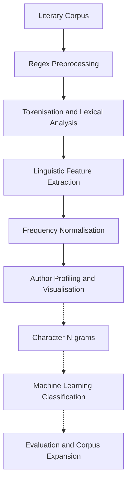

# Style Fingerprint

**Computational Stylometry & Authorship Attribution**

Independent project in computational linguistics and natural language processing (NLP), developed alongside the postgraduate programme in Computer-Assisted Language Mediation (CALM) at Ghent University.

**Status:** Active development — exploratory linguistic analysis implemented; machine learning classification planned.

**Technologies:** Python, regular expressions, collections.Counter, Matplotlib, Git and GitHub.

## 1. Problem & Research Objective

Can measurable linguistic patterns help distinguish the writing styles of different authors?

Style Fingerprint investigates how computational stylometry, linguistic feature extraction and statistical text analysis can reveal author-specific patterns. Its long-term objective is to develop a reproducible, extensible pipeline for automated authorship attribution on previously unseen texts.

The project bridges linguistic analysis and computational methods, moving from interpretable features towards supervised machine learning.

## 2. Dataset

The initial experimental corpus comprises four English-language novels obtained from Project Gutenberg:

| Author | Novel | Local filename | Tokens |
| --- | --- | --- | ---: |
| Jane Austen | [Emma](https://www.gutenberg.org/ebooks/158) | `austen_emma.txt` | 160,872 |
| Jane Austen | [Pride and Prejudice](https://www.gutenberg.org/ebooks/1342) | `austen_pride.txt` | 122,825 |
| Charles Dickens | [A Tale of Two Cities](https://www.gutenberg.org/ebooks/98) | `dickens_cities.txt` | 136,938 |
| Charles Dickens | [Oliver Twist](https://www.gutenberg.org/ebooks/730) | `dickens_twist.txt` | 158,105 |
| | **Total** | | **578,740** |

Token counts reflect a recorded preprocessing/tokenisation run and may change as the pipeline is refined. The corpus serves as a pilot dataset, not a representative benchmark for authorship attribution.

## 3. Methodology

The current pipeline consists of the following stages:

1. **Corpus preprocessing:** remove Project Gutenberg headers and footers, chapter headings and other identified non-literary material using regular expressions and text-specific anchors.
2. **Tokenisation and lexical analysis:** extract tokens, count total and unique tokens, calculate type-token ratio (TTR), and analyse word frequencies using Python's `Counter`.
3. **Linguistic feature extraction:** extract frequencies for a selected set of function words, including articles, pronouns, conjunctions and prepositions.
4. **Frequency normalisation:** express feature counts per 10,000 tokens to support comparisons between texts of unequal length.
5. **Author profiling and visualisation:** aggregate book-level features into exploratory author profiles and visualise stylistic differences using Matplotlib.

Normalised frequency = (word count / total tokens) × 10,000.

The planned next stage is character n-gram feature extraction, followed by supervised classification and evaluation.


## 4. Preliminary Results

The current analysis reveals differences in the distribution of selected function words between individual novels and in the exploratory author profiles. For example, the following recorded values illustrate variation within Jane Austen's works:

| Function word | Emma | Pride and Prejudice |
| --- | ---: | ---: |
| the | 323.49 | 354.98 |
| and | 304.40 | 292.45 |
| she | 146.95 | 139.47 |
| her | 154.35 | 181.56 |

All values are occurrences per 10,000 tokens. These observations are descriptive, not evidence of reliable authorship prediction. No trained classifier or held-out accuracy scores are reported at this stage.

## 5. Error Analysis & Limitations

- The pilot corpus contains only two authors and four books; author, topic, genre and period effects may be confounded.
- Preprocessing must distinguish structural headings from genuine narrative text. Book-specific cleaning rules may require adaptation for new sources.
- TTR is sensitive to text length; normalised word frequencies do not eliminate every source of bias.
- Tokenisation choices and author-profile aggregation can influence the resulting features.
- Model-level error analysis will follow once classifiers have been trained and evaluated.

Future evaluation will use book-level splits to avoid leakage between training and test passages from the same novel, alongside a larger corpus and appropriate baseline comparisons.

## 6. Roadmap & Extensibility

- [x] Corpus collection and regex-based cleaning
- [x] Tokenisation, lexical statistics and word-frequency analysis
- [x] Normalised function-word features and exploratory author profiles
- [x] Comparative data visualisation
- [ ] Character n-gram feature extraction
- [ ] Feature matrix construction and supervised classification
- [ ] Held-out evaluation, baselines and error analysis
- [ ] Expansion to additional authors, books and literary genres
- [ ] More reusable ingestion, automated tests and reproducibility improvements

The modular structure is intended to support additional feature families, larger datasets and alternative classification models. Scalability and generalisation have not yet been benchmarked.

## 7. Repository Structure

```text
style-fingerprint/
├── data/                   # Local corpus files (create if absent)
├── src/
│   ├── text_cleaning.py    # Corpus preprocessing
│   └── text_analysis.py    # Lexical and stylistic analysis
├── main.py                 # Pipeline entry point
├── .gitignore
└── README.md
```

## 8. How to Run

With Python 3 installed, open a terminal in the project directory and create a virtual environment:

```bash
python3 -m venv .venv
source .venv/bin/activate
python -m pip install matplotlib
```

Create a `data/` directory if necessary. Download the plain-text editions of the four novels from the Project Gutenberg links above and save them under the filenames listed in the dataset table.

Run the current pipeline from the repository root:

```bash
python main.py
```

The current analysis produces lexical statistics, normalised function-word frequencies and comparative visualisations. Setup instructions reflect the known macOS/Python workflow; dependency versions and clean-environment execution still need to be documented and tested.

## 9. Author

**Mohammed Alashqar**  
Postgraduate student in Computer-Assisted Language Mediation (CALM), Ghent University  
Research interests: computational linguistics, NLP, stylometry, machine learning and applied AI.

[LinkedIn](https://www.linkedin.com/in/mohammed-alashqar2000/)

---

*This project is under active development as part of my independent learning and technical portfolio. Findings are preliminary and subject to further validation.*
